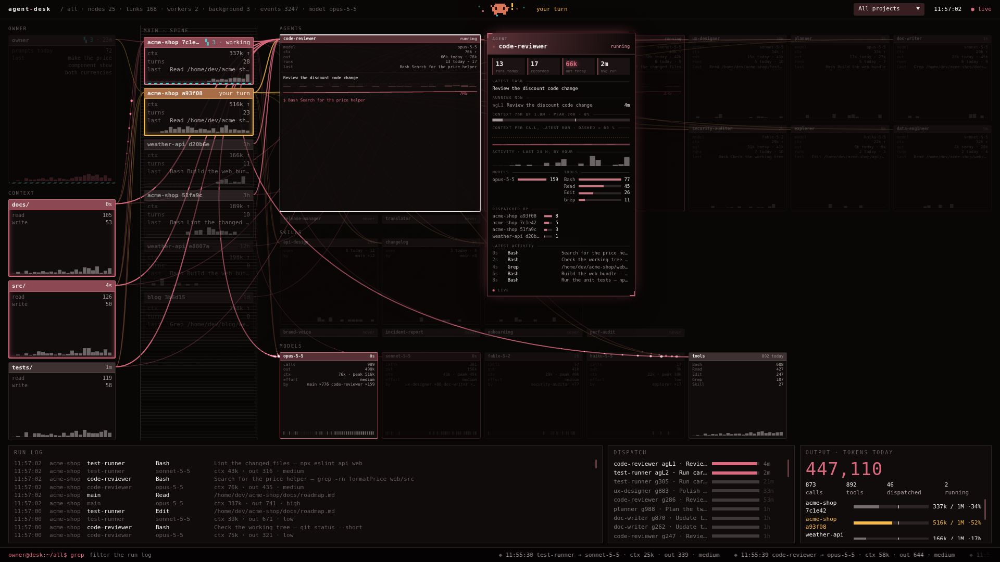
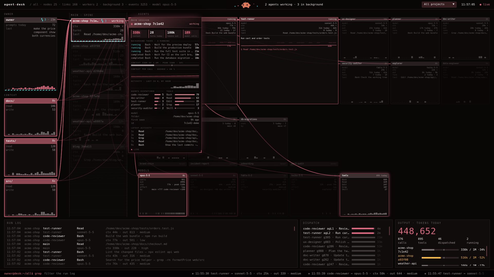

# AI Observability for Claude Code

A second brain dashboard for agent and models monitoring and health.


One local page that shows, live, what every Claude Code session on your machine is doing: your prompts, the main sessions, every sub-agent and the model it runs on, skills and who used them, tool calls, token output, and how full each context window is (amber at 50%, red at 60%). It finds all projects by itself — any agents, any models — and lets you filter by project.

A tile with work still running in the background (a command, an agent or a workflow sent there) carries a moving teal edge and a count; so do its session and the owner tile.

In the middle of the title bar lives the desk buddy, a small pixel creature that acts out the state of the desk: asleep after five quiet minutes, watching when idle, pacing and hopping on every event while work flows, jumping and waving when a session waits for you. Pink dots circling it are running agents, teal ones background tasks. Click it.



Hover any tile (or reach it with Tab) for a live card with its full detail: key figures, context against its window, activity charts, who called it, which models and tools it used, and its latest actions. Everything linked to that tile stays lit while the rest steps back.

The lower band opens the same card: a run log line shows its full text and event details, a dispatch row the whole agent run, the token figure where the output went (by hour, model, agent and session), and a context row its session.

The token card also shows your subscription limits (5-hour and weekly, with reset times) when Claude Code supplies them. They come through a status line command, `statusline.mjs`, which the install script sets up only if you have no status line of your own. Claude Code hands these figures to subscribers only, after the first reply of a session.



Everything stays on your machine: one Node process on `127.0.0.1:4777`, no dependencies, no network calls.

## Know before you use it

**Does it monitor one session or the whole Claude Code environment?**

- The whole environment on your machine.
- Every session in every project shows up on the same page.

**How does it work?**

1. Hooks in your user-level `settings.json` fire in every Claude Code session, whatever the project, and append one line per prompt, tool call, sub-agent start/stop and stop to `~/.claude/monitor/events.jsonl`.
2. One small Node process tails that log and reads the session transcripts for the model, effort and token counts of each call.
3. It streams both to the page as they happen.

**How do I tell sessions apart?**

- Each session is its own tile in the MAIN SPINE column, labelled with its project folder and the start of its session id.
- The 20 most recent are shown.

**How are projects found?**

- From each session's working folder; a worktree counts as its parent project.
- The "All projects" menu at the top right filters the whole page to one project.

**Which agents and skills are listed?**

- Those defined for your user, plus those in the `.claude/` folder of every project seen so far.

**What do the totals cover?**

- The owner tile, models, tools and token counter add up every session, or only the project you filtered to.

**Does it see other machines or cloud sessions?**

- No.
- Only sessions run under your account on this computer.

**What about sessions started before the install?**

- They have no hook events.
- Only their token and context figures for the last 24 hours are picked up.

## Requirements

- Claude Code
- Node.js 22 or newer (`node -v`)
- A recent Chrome or Edge for the page

## Install

Pick one.

### A. As a Claude Code plugin (any OS)

Inside Claude Code:

```
/plugin marketplace add rubinato/ai-observability-for-claude-code
/plugin install ai-observability@ai-observability-for-claude-code
```

Restart Claude Code, then run `/ai-observability:observe` to start the dashboard.

### B. With the install script

macOS, Ubuntu, Debian:

```bash
git clone https://github.com/rubinato/ai-observability-for-claude-code.git && sh ai-observability-for-claude-code/install.sh
```

Windows (PowerShell):

```powershell
git clone https://github.com/rubinato/ai-observability-for-claude-code.git; .\ai-observability-for-claude-code\install.ps1
```

Without a clone, on any OS: `npx -y github:rubinato/ai-observability-for-claude-code install`

### C. Offline, from the zip

For a machine without internet access. Copy `ai-observability-for-claude-code.zip` to it, unzip, and run the script for its system from the unzipped folder:

| System | Run |
|---|---|
| Windows | double-click `install.cmd` (or `.\install.ps1` in PowerShell) |
| macOS | `sh install.sh` |
| Ubuntu / Debian | `sh install.sh` |

Nothing is downloaded: the zip holds every file and the app has no dependencies. Node.js 22 or newer must already be on the machine; its offline installers are at <https://nodejs.org/en/download>. Build the zip from a clone with `npm run zip`.

The script copies five files to `~/.claude/monitor/` and adds one hook line per event to `~/.claude/settings.json` (a copy of the old file is kept as `settings.json.bak`; your own hooks are not touched). Use A or B, not both, or every event is logged twice.

Need Node? macOS `brew install node` · Windows `winget install OpenJS.NodeJS.LTS` · Ubuntu/Debian: [NodeSource](https://github.com/nodesource/distributions) (the distro package is often too old).

## Use

```bash
node ~/.claude/monitor/server.mjs
```

Windows: `node "$HOME\.claude\monitor\server.mjs"`

Open <http://localhost:4777>. Leave the process running; the page reconnects by itself. Sessions started after the install are recorded; token and context figures also cover the last 24 hours of earlier sessions.

| Setting | Default | Meaning |
|---|---|---|
| `PORT` | `4777` | port of the dashboard |
| `CLAUDE_CONFIG_DIR` | `~/.claude` | Claude Code's config folder, if you moved it |

## What it reads

- Hook events (prompt, tool call, sub-agent start/stop, stop), written to `~/.claude/monitor/events.jsonl`. Each text field is cut to 240 characters.
- Session transcripts in `~/.claude/projects/`, for model, effort and token counts only.
- Agent and skill names from `~/.claude/agents/` and `~/.claude/skills/`, and the same folders in each project's `.claude/`. A plugin's skill appears once it has been used.

The log holds the start of your prompts and commands in plain text and is never trimmed; delete `events.jsonl` whenever you like.

## Security

- The server listens on `127.0.0.1` only and answers only requests addressed to `localhost` or `127.0.0.1`. It has no login: anyone who can use a browser on your machine can read the page.
- The log is created readable by your user only. A secret typed in the first 240 characters of a prompt or command is stored in it, so treat the file like your shell history.
- The page loads nothing from the internet and sends nothing out.

## Uninstall

Plugin: `/plugin uninstall ai-observability@ai-observability-for-claude-code`
Script: `node ~/.claude/monitor/cli.mjs uninstall`, then delete `~/.claude/monitor/`.

## Limits

- The context window size is not in the data: a model is treated as 1M once it has been seen above 200k, else 200k.
- On start only the last 1 MB of each transcript is replayed.
- The styled scrollbars and project menu need a Chromium browser; elsewhere they fall back to plain ones.

- Nothing reports a background task that died with its session, so a task shows as running only while its session was active in the last 2 hours.

## Develop

`npm test` runs the installer check in a throwaway folder. Files: `hook.mjs` (logger), `statusline.mjs` (usage limits), `server.mjs` (stream), `index.html` (page), `cli.mjs` (installer).

MIT licence.
