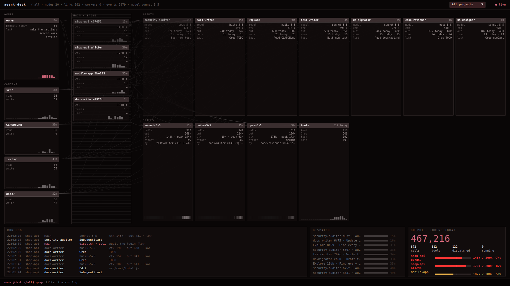

# AI Observability for Claude Code

A second brain dashboard for agent and models monitoring and health.


One local page that shows, live, what every Claude Code session on your machine is doing: your prompts, the main sessions, every sub-agent and the model it runs on, tool calls, token output, and how full each context window is (amber at 50%, red at 60%). It finds all projects by itself — any agents, any models — and lets you filter by project.

Everything stays on your machine: one Node process on `127.0.0.1:4777`, no dependencies, no network calls.

## Requirements

- Claude Code
- Node.js 22 or newer (`node -v`)
- A recent Chrome or Edge for the page

## Install

Pick one.

### A. As a Claude Code plugin (any OS)

Inside Claude Code:

```
/plugin marketplace add rubinato/ai-observability-for-claude-code
/plugin install ai-observability@ai-observability-for-claude-code
```

Restart Claude Code, then run `/ai-observability:observe` to start the dashboard.

### B. With the install script

macOS, Ubuntu, Debian:

```bash
git clone https://github.com/rubinato/ai-observability-for-claude-code.git && sh ai-observability-for-claude-code/install.sh
```

Windows (PowerShell):

```powershell
git clone https://github.com/rubinato/ai-observability-for-claude-code.git; .\ai-observability-for-claude-code\install.ps1
```

Without a clone, on any OS: `npx -y github:rubinato/ai-observability-for-claude-code install`

The script copies four files to `~/.claude/monitor/` and adds one hook line per event to `~/.claude/settings.json` (a copy of the old file is kept as `settings.json.bak`; your own hooks are not touched). Use A or B, not both, or every event is logged twice.

Need Node? macOS `brew install node` · Windows `winget install OpenJS.NodeJS.LTS` · Ubuntu/Debian: [NodeSource](https://github.com/nodesource/distributions) (the distro package is often too old).

## Use

```bash
node ~/.claude/monitor/server.mjs
```

Windows: `node "$HOME\.claude\monitor\server.mjs"`

Open <http://localhost:4777>. Leave the process running; the page reconnects by itself. Sessions started after the install are recorded; token and context figures also cover the last 24 hours of earlier sessions.

| Setting | Default | Meaning |
|---|---|---|
| `PORT` | `4777` | port of the dashboard |
| `CLAUDE_CONFIG_DIR` | `~/.claude` | Claude Code's config folder, if you moved it |

## What it reads

- Hook events (prompt, tool call, sub-agent start/stop, stop), written to `~/.claude/monitor/events.jsonl`. Each text field is cut to 240 characters.
- Session transcripts in `~/.claude/projects/`, for model, effort and token counts only.
- Agent names from `~/.claude/agents/` and each project's `.claude/agents/`.

The log holds the start of your prompts and commands in plain text and is never trimmed; delete `events.jsonl` whenever you like.

## Security

- The server listens on `127.0.0.1` only and answers only requests addressed to `localhost` or `127.0.0.1`. It has no login: anyone who can use a browser on your machine can read the page.
- The log is created readable by your user only. A secret typed in the first 240 characters of a prompt or command is stored in it, so treat the file like your shell history.
- The page loads nothing from the internet and sends nothing out.

## Uninstall

Plugin: `/plugin uninstall ai-observability@ai-observability-for-claude-code`
Script: `node ~/.claude/monitor/cli.mjs uninstall`, then delete `~/.claude/monitor/`.

## Limits

- The context window size is not in the data: a model is treated as 1M once it has been seen above 200k, else 200k.
- On start only the last 1 MB of each transcript is replayed.
- The styled scrollbars and project menu need a Chromium browser; elsewhere they fall back to plain ones.

## Develop

`npm test` runs the installer check in a throwaway folder. Files: `hook.mjs` (logger), `server.mjs` (stream), `index.html` (page), `cli.mjs` (installer).

MIT licence.
